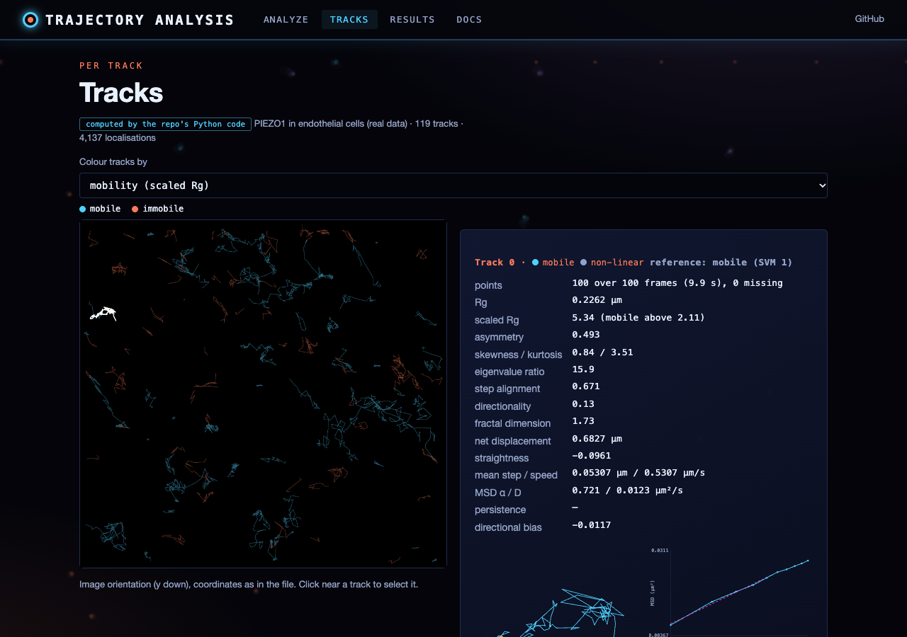
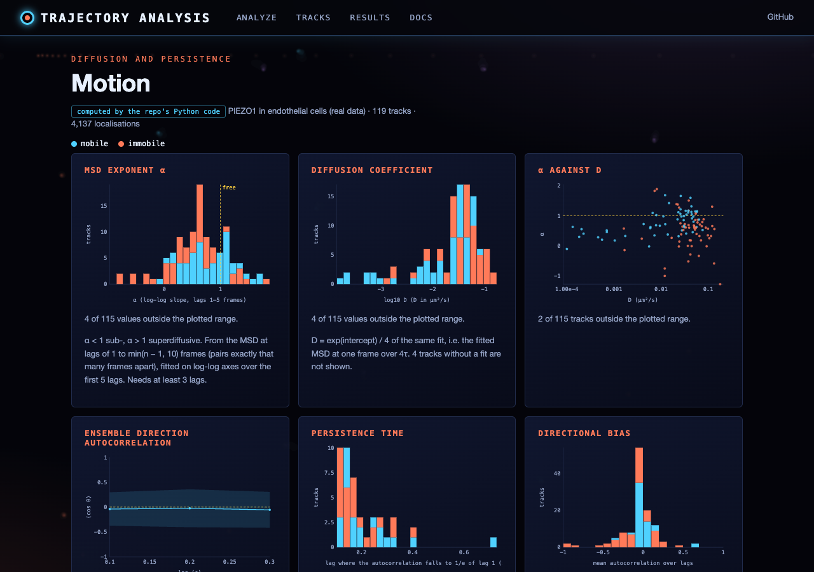
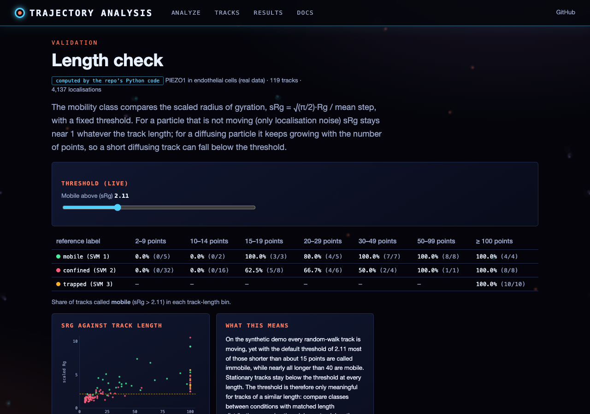

# Particle Tracking Application

A comprehensive, modular application for analyzing particle trajectories from TIRF microscopy recordings and other single-molecule imaging data.

## Features

### 🔬 **Multi-Method Particle Detection**
- Threshold-based detection
- Laplacian of Gaussian (LoG) blob detection
- Trackpy integration
- Background subtraction and filtering

### 🔗 **Advanced Trajectory Linking**
- Nearest neighbor linking
- Trackpy-based linking with gap filling
- Adaptive search parameters
- Minimum track length filtering

### 📊 **Comprehensive Feature Analysis**
- Radius of gyration (simple and tensor methods)
- Asymmetry, skewness, kurtosis
- Fractal dimension
- Mean squared displacement (MSD)
- Velocity and diffusion analysis
- Nearest neighbor distances

### 🤖 **Machine Learning Classification**
- SVM-based trajectory classification
- Threshold-based mobility classification
- Custom feature selection
- Training data import

### 📈 **Interactive Visualization**
- Real-time image display with overlays
- Track visualization with customizable colors
- Feature-based coloring schemes
- Playback controls for time series
- Export capabilities

### 💼 **Project Management**
- Save and load analysis projects
- Parameter persistence
- Data file management
- Analysis result tracking

## Installation

### Prerequisites
- Python 3.8 or higher
- pip package manager

### Install from Source
```bash
git clone https://github.com/gddickinson/trajectory_analysis.git
cd trajectory_analysis
pip install -e .
```

### Development Installation
```bash
git clone https://github.com/gddickinson/trajectory_analysis.git
cd trajectory_analysis
pip install -e ".[dev,docs,optional]"
```

## Quick Start

### GUI Application
```bash
# Start the application
particle-tracker

# Or run directly
python main.py

# With debug logging
python main.py --debug

# Load a project on startup
python main.py --project my_analysis.ptproj

# Load data on startup
python main.py --data my_tirf_movie.tif
```

### Python API
```python
import numpy as np
from particle_tracker import ParticleTrackingApp, AnalysisEngine, AnalysisParameters

# Load your data
image_data = np.load("my_tirf_data.npy")

# Set up analysis parameters
params = AnalysisParameters(
    detection_method="threshold",
    detection_threshold=3.0,
    linking_method="nearest_neighbor",
    max_distance=5.0,
    pixel_size=108.0,  # nm per pixel
    frame_rate=10.0    # Hz
)

# Create analysis engine
engine = AnalysisEngine()

# Run the pipeline in a background QThread (a Qt event loop must be running);
# results arrive through the engine's stepCompleted / analysisCompleted signals
from particle_tracker import AnalysisStep
engine.run_analysis_pipeline(
    image_data,
    params,
    steps=[AnalysisStep.DETECTION, AnalysisStep.LINKING, AnalysisStep.FEATURES, AnalysisStep.CLASSIFICATION]
)
```

For track tables without Qt, call the analysis classes directly, e.g.
`particle_tracker.analysis.features.FeatureCalculator().calculate_features(df)` on a DataFrame with
`track_number, frame, x, y` columns (pixels and frame numbers).

## Web interface

Analyse a finished track table (one row per localisation: track, frame, x, y) in the browser or with a local server.
Live site: <https://gddickinson.github.io/trajectory_analysis/> (published from `main` once GitHub Pages is enabled).

- **Analyze**: upload a CSV or pick a demo, give the units (pixel size in µm/pixel, frame interval in s) and parameters;
  per-class summaries and a per-track CSV with the units in its column names.
- **Tracks**: map of all tracks coloured by mobility, linearity or reference label; per-track features, MSD with its
  log-log fit, direction autocorrelation.
- **Features / Motion / Density**: distributions of Rg, scaled Rg, asymmetry, skewness, kurtosis, fractal dimension,
  straightness, linearity; MSD exponent and D; ensemble direction autocorrelation and persistence; nearest-neighbour
  distances and neighbour counts.
- **Length check**: how the scaled-Rg mobility class depends on track length, on labelled tracks from the repo's test
  generators.

The analyses are the repo's own classes (`FeatureCalculator`, `AdvancedMetricsCalculator`, `DirectionAutocorrelationAnalyzer`).
On the static site they run in your browser through a JavaScript port that a node test checks against the Python output
(rtol 1e-9); uploaded files never leave your computer. Demo data: the real PIEZO1 example recording in
`particle_tracker/resources/example_data/` and tracks from `tests/__init__.py`'s generators (labelled as simulated).
Detection, linking, SVM classification and image-based steps stay in the desktop app.

```bash
pip install -r requirements-web.txt
python run_web.py                     # http://127.0.0.1:8212
python -m pytest -q tests/test_web.py # API, static build, JS-vs-Python fixture, node engine test
python scripts/build_static.py        # static site in site/
```

| Tracks | Motion | Length check |
|---|---|---|
|  |  |  |

## Usage Guide

### 1. Loading Data
The application supports various data formats:
- **Images**: TIFF, PNG, JPEG (2D or 3D time series)
- **Localizations**: CSV files with x, y, frame columns
- **Trajectories**: CSV files with track_number column
- **Analysis Results**: Excel, JSON formats

### 2. Analysis Workflow

#### Step 1: Particle Detection
Configure detection parameters:
- **Method**: Choose from threshold, LoG, or trackpy
- **Sigma**: Expected particle size (1-3 pixels typical)
- **Threshold**: Detection sensitivity (2-5σ recommended)

#### Step 2: Trajectory Linking
Set linking parameters:
- **Max Distance**: Maximum particle movement between frames
- **Max Gap**: Number of frames a particle can disappear
- **Min Track Length**: Filter short, noisy trajectories

#### Step 3: Feature Calculation
Calculate trajectory features:
- **Radius of Gyration**: Spatial extent of trajectories
- **Asymmetry**: Shape anisotropy
- **Diffusion Coefficient**: From MSD analysis
- **Velocity**: Instantaneous and mean velocities

#### Step 4: Classification
Classify trajectory behavior:
- **SVM Method**: Train on labeled data
- **Threshold Method**: Simple mobility criteria

#### Mobile / immobile by the scaled radius of gyration (sRg)
sRg = √(π/2)·Rg / mean step (Golan & Sherman 2017, [doi:10.1038/ncomms15851](https://doi.org/10.1038/ncomms15851);
Ly et al. 2025, [doi:10.1016/j.bpj.2025.01.010](https://doi.org/10.1016/j.bpj.2025.01.010)) is ≈ 1 for an immobile
particle whatever its localisation error; a track is *mobile* above a threshold. Options (desktop Classification
panel, web Analyze form, `scripts/classify_mobility.py`, or parameters `srg_preset`, `srg_definition`,
`mobility_threshold`, `min_classify_length`; all in `particle_tracker/analysis/mobility.py`):
- **Presets**: membrane protein, TIRF (2.11, ≥ 50 points; default), PIEZO1-tdTomato TIRF 10 fps (2.2224, ≥ 200 points),
  fixed / immobile reference, strict (3.89), fast diffuser with short tracks (2.11, ≥ 40), legacy (2.11, every track
  classified, as before 2026-11), custom. Each preset states where its numbers come from (the PIEZO1 threshold and
  how Ly et al. 2025 derived it: `docs/srg_calibration.md`, section 5).
- **Minimum track length**: shorter tracks are reported as *too short*, not immobile. A diffusing track's sRg grows about
  as √(N/3), so short free tracks fall below any fixed threshold (simulations: `docs/srg_calibration.md`, made by
  `scripts/srg_calibration.py`).
- **Definition**: `golan_sherman` (above, recommended) or `rg_over_step` = Rg / mean step (the `radius_gyration_scaled`
  column of the lab's original scripts); thresholds are converted between them.
- Best practice from both papers: set the threshold from a fixed sample of your own
  (`python scripts/classify_mobility.py live.csv --reference fixed.csv`, 95th percentile).

### 3. Visualization and Analysis
- Use the visualization panel to inspect results
- Color trajectories by features or classification
- Export results to CSV or generate reports

## File Formats

### Project Files (.ptproj)
JSON format containing:
- Analysis parameters
- Data file references
- Results metadata
- Project notes

### Data Export Formats
- **CSV**: Comma-separated values
- **Excel**: Multi-sheet workbooks
- **JSON**: Structured data format

## Advanced Usage

### Batch Processing
Batch runs over many files are driven from the GUI's batch panel
(`particle_tracker/core/batch_analysis.py`, `BatchAnalysisManager`); there is no separate
command-line batch API yet.

### Custom Analysis Methods
```python
from particle_tracker.analysis.detection import DetectionMethod

class MyCustomDetection(DetectionMethod):
    def detect(self, image, **kwargs):
        # Your custom detection algorithm
        return detections_dataframe

# Register your method
detector = ParticleDetector()
detector.methods['my_method'] = MyCustomDetection()
```

## API Reference

### Core Classes
- `ParticleTrackingApp`: Main application class
- `DataManager`: Handles data loading and management
- `AnalysisEngine`: Coordinates analysis workflows
- `ProjectManager`: Manages projects and settings

### Analysis Components
- `ParticleDetector`: Particle detection methods
- `ParticleLinker`: Trajectory linking algorithms
- `FeatureCalculator`: Trajectory feature computation
- `TrajectoryClassifier`: Classification methods

### GUI Components
- `MainWindow`: Main application interface
- `VisualizationWidget`: Image and trajectory display
- `ParameterPanels`: Analysis parameter controls

## Contributing

We welcome contributions! Please see [CONTRIBUTING.md](CONTRIBUTING.md) for guidelines.

### Development Setup
```bash
git clone https://github.com/gddickinson/trajectory_analysis.git
cd trajectory_analysis
pip install -e ".[dev]"
pre-commit install
```

### Running Tests
```bash
pytest tests/
```

## License

This project is licensed under the MIT License - see [LICENSE](LICENSE) file for details.

## Citation

If you use this software in your research, please cite:

```bibtex
@software{particle_tracker,
  title={Particle Tracking Application},
  author={Your Name},
  year={2024},
  url={https://github.com/yourusername/particle-tracker}
}
```

## Acknowledgments

- Built on scientific Python ecosystem (NumPy, SciPy, scikit-learn)
- GUI powered by PyQt6 and pyqtgraph
- Inspired by particle tracking workflows in biophysics research
- Consolidates and extends functionality from multiple analysis scripts

## Support

- 📖 [Documentation](https://particle-tracker.readthedocs.io/)
- 🐛 [Issue Tracker](https://github.com/yourusername/particle-tracker/issues)
- 💬 [Discussions](https://github.com/yourusername/particle-tracker/discussions)
- 📧 [Email Support](mailto:your.email@example.com)

